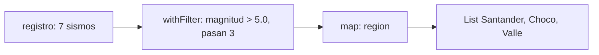
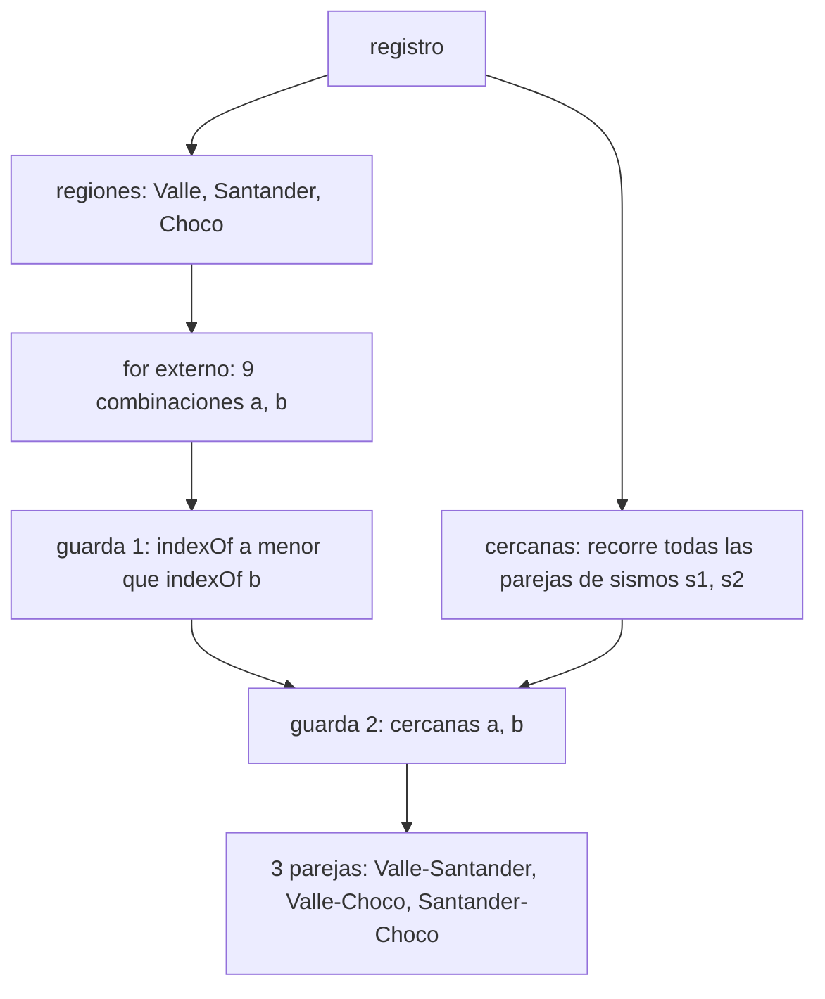
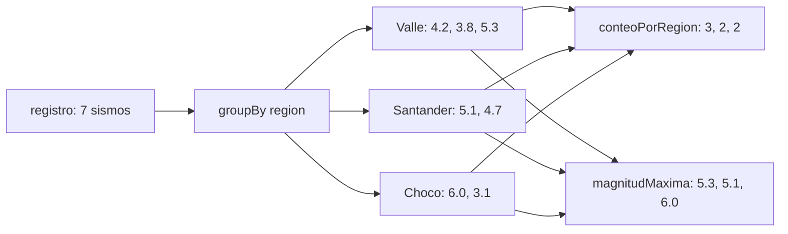
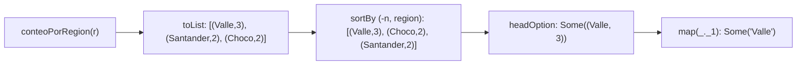
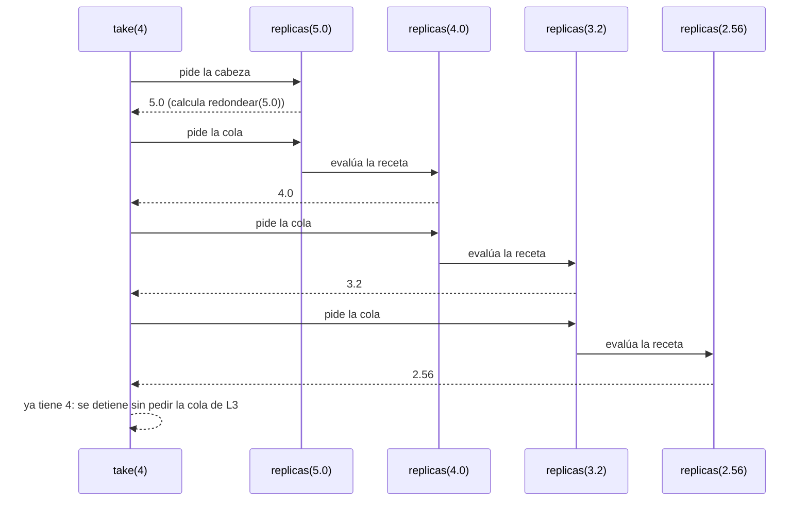
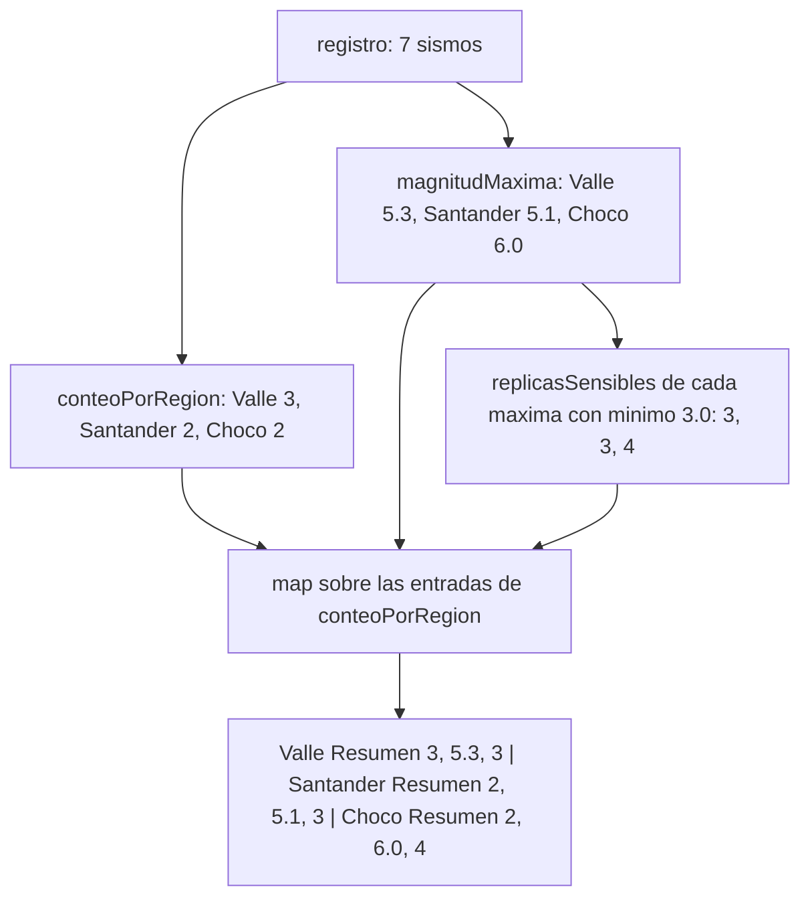

# Informe de proceso

Este informe explica cómo se ejecuta cada función de los Puntos 1 y 2 sobre el
registro de ejemplo del enunciado, y en qué operaciones se traduce cada
expresión `for`. Las traducciones se obtuvieron del compilador
(`scalac -Xprint:parser`) y las trazas salen de ejecutar el código, no de
cálculos a mano.

## Registro de ejemplo

```Scala
val registro = List(
  Sismo(Fecha(2025, 3), "Valle", 4.2, 30),
  Sismo(Fecha(2025, 3), "Santander", 5.1, 150),
  Sismo(Fecha(2025, 4), "Valle", 3.8, 25),
  Sismo(Fecha(2025, 4), "Choco", 6.0, 40),
  Sismo(Fecha(2025, 5), "Santander", 4.7, 160),
  Sismo(Fecha(2025, 5), "Valle", 5.3, 35),
  Sismo(Fecha(2025, 6), "Choco", 3.1, 20)
)
```

En las trazas, el número de la primera columna es la posición del sismo en el
registro (del 1 al 7).

## Cómo se traduce una expresión `for`

El compilador reescribe cada `for` con `yield` en llamadas a `map`, `flatMap` y
`withFilter`:

| Forma del `for` | Se traduce a |
|-----------------|--------------|
| `for { x <- e } yield f` | `e.map(x => f)` |
| `for { x <- e; if p } yield f` | `e.withFilter(x => p).map(x => f)` |
| `for { x <- e1; y <- e2 } yield f` | `e1.flatMap(x => e2.map(y => f))` |

La regla general es: el **último** generador se traduce a `map`, cada generador
**anterior** a `flatMap`, y cada guarda `if` a un `withFilter`. `withFilter`
no construye una lista intermedia: deja pasar cada elemento solo si cumple la
condición, y el `map` que sigue transforma únicamente los que pasaron.

Las expresiones `for` que usa el código, con la traducción exacta que imprime
el compilador:

| Función | Expresión `for` | Traducción |
|---------|-----------------|------------|
| `fuertes` | `for { s <- r; if s.magnitud > umbral } yield s.region` | `r.withFilter(s => s.magnitud > umbral).map(s => s.region)` |
| `enRegion` | `for { s <- r; if s.region == region } yield s.magnitud` | `r.withFilter(s => s.region == region).map(s => s.magnitud)` |
| `paresCercanos` (regiones) | `for (s <- r) yield s.region` | `r.map(s => s.region)` |
| `paresCercanos` (`cercanas`) | `for { s1 <- r; s2 <- r; if ...; if ... } yield (s1, s2)` | `r.flatMap(s1 => r.withFilter(s2 => s1.region == a && s2.region == b).withFilter(s2 => Math.abs(s1.magnitud - s2.magnitud) <= dif).map(s2 => (s1, s2)))` |
| `paresCercanos` (resultado) | `for { a <- regiones; b <- regiones; if ...; if ... } yield (a, b)` | `regiones.flatMap(a => regiones.withFilter(b => regiones.indexOf(a) < regiones.indexOf(b)).withFilter(b => cercanas(a, b)).map(b => (a, b)))` |

## Punto 1: consultas con expresiones `for`

### `fuertes`

```Scala
def fuertes(r: Registro, umbral: Double): List[String] =
  for {
    s <- r
    if s.magnitud > umbral
  } yield s.region
```

Se traduce a `r.withFilter(s => s.magnitud > umbral).map(s => s.region)`. Cada
sismo del registro, en orden, pasa por la guarda `magnitud > umbral`. Si la
cumple, `map` entrega su región; si no, se descarta. Como no hay ninguna
operación que quite repetidos, una región con varios sismos fuertes aparece
varias veces.

Ejecución de `fuertes(registro, 5.0)`:

| # | Región | Magnitud | Guarda | Aporta al resultado |
|:-:|--------|:--------:|--------|---------------------|
| 1 | Valle     | 4.2 | `4.2 > 5.0` es false | se descarta |
| 2 | Santander | 5.1 | `5.1 > 5.0` es true  | `"Santander"` |
| 3 | Valle     | 3.8 | `3.8 > 5.0` es false | se descarta |
| 4 | Choco     | 6.0 | `6.0 > 5.0` es true  | `"Choco"` |
| 5 | Santander | 4.7 | `4.7 > 5.0` es false | se descarta |
| 6 | Valle     | 5.3 | `5.3 > 5.0` es true  | `"Valle"` |
| 7 | Choco     | 3.1 | `3.1 > 5.0` es false | se descarta |

Resultado: `List("Santander", "Choco", "Valle")`.



### `enRegion`

```Scala
def enRegion(r: Registro, region: String): List[Double] =
  for {
    s <- r
    if s.region == region
  } yield s.magnitud
```

Se traduce a `r.withFilter(s => s.region == region).map(s => s.magnitud)`. Es la
misma estructura que `fuertes`, con otra guarda y otra proyección: se queda con
los sismos de la región pedida y entrega su magnitud, en el orden del registro.
Si la región no está, ningún sismo pasa la guarda y el resultado es la lista
vacía.

Ejecución de `enRegion(registro, "Valle")`:

| # | Región | Guarda | Aporta al resultado |
|:-:|--------|--------|---------------------|
| 1 | Valle     | `"Valle" == "Valle"` es true      | `4.2` |
| 2 | Santander | `"Santander" == "Valle"` es false | se descarta |
| 3 | Valle     | `"Valle" == "Valle"` es true      | `3.8` |
| 4 | Choco     | `"Choco" == "Valle"` es false     | se descarta |
| 5 | Santander | `"Santander" == "Valle"` es false | se descarta |
| 6 | Valle     | `"Valle" == "Valle"` es true      | `5.3` |
| 7 | Choco     | `"Choco" == "Valle"` es false     | se descarta |

Resultado: `List(4.2, 3.8, 5.3)`.

### `paresCercanos`

```Scala
def paresCercanos(r: Registro, dif: Double): List[(String, String)] = {
  val regiones = (for (s <- r) yield s.region).distinct

  def cercanas(a: String, b: String): Boolean =
    (for {
      s1 <- r
      s2 <- r
      if s1.region == a && s2.region == b
      if Math.abs(s1.magnitud - s2.magnitud) <= dif
    } yield (s1, s2)).nonEmpty

  for {
    a <- regiones
    b <- regiones
    if regiones.indexOf(a) < regiones.indexOf(b)
    if cercanas(a, b)
  } yield (a, b)
}
```

La función trabaja en tres pasos.

**Paso 1: las regiones en orden de aparición.** `(for (s <- r) yield s.region)`
se traduce a `r.map(s => s.region)`, que da una región por cada sismo, y
`.distinct` conserva solo la primera aparición de cada una. Para el registro de
ejemplo: `List("Valle", "Santander", "Choco")`.

**Paso 2: `cercanas(a, b)`.** Su `for` se traduce a un `flatMap` sobre `s1`, y
dentro de él un `withFilter` (la guarda de las regiones), un segundo
`withFilter` (la guarda de la diferencia) y un `map` que arma la pareja de
sismos. Cada combinación `(s1, s2)` de sismos del registro se examina en ese
orden. La función devuelve `true` si queda al menos una pareja (`.nonEmpty`),
es decir, si existe algún sismo de `a` y algún sismo de `b` cuyas magnitudes
difieren a lo sumo `dif`.

**Paso 3: las parejas de regiones.** El `for` externo recorre todas las
combinaciones `(a, b)` de regiones. La primera guarda,
`regiones.indexOf(a) < regiones.indexOf(b)`, solo deja pasar las combinaciones
en que `a` aparece antes que `b`. Esto elimina las parejas con una región
repetida (`(a, a)`) y garantiza que cada pareja salga en un solo orden:
`("Valle", "Choco")` pasa, pero `("Choco", "Valle")` no. La segunda guarda llama
a `cercanas`. El resultado conserva el orden de los generadores: primero todas
las parejas de la primera región, luego las de la segunda, y así.

Ejecución de `paresCercanos(registro, 1.0)`. Con `regiones` igual a
`List("Valle", "Santander", "Choco")`, el `for` externo examina las nueve
combinaciones:

| `a` | `b` | `indexOf(a) < indexOf(b)` | `cercanas(a, b)` | Resultado |
|-----|-----|---------------------------|------------------|-----------|
| Valle     | Valle     | `0 < 0` es false | no se evalúa | se descarta |
| Valle     | Santander | `0 < 1` es true  | true (5 parejas de sismos cumplen) | `("Valle", "Santander")` |
| Valle     | Choco     | `0 < 2` es true  | true (2 parejas de sismos cumplen) | `("Valle", "Choco")` |
| Santander | Valle     | `1 < 0` es false | no se evalúa | se descarta |
| Santander | Santander | `1 < 1` es false | no se evalúa | se descarta |
| Santander | Choco     | `1 < 2` es true  | true (1 pareja de sismos cumple) | `("Santander", "Choco")` |
| Choco     | Valle     | `2 < 0` es false | no se evalúa | se descarta |
| Choco     | Santander | `2 < 1` es false | no se evalúa | se descarta |
| Choco     | Choco     | `2 < 2` es false | no se evalúa | se descarta |

`cercanas` solo se evalúa cuando la primera guarda se cumple, porque los dos
`withFilter` se aplican en cadena a cada elemento.

Por dentro, `cercanas("Valle", "Santander")` examina las seis combinaciones de
un sismo del Valle con uno de Santander:

| Sismo de Valle | Sismo de Santander | Diferencia | `<= 1.0` |
|:--------------:|:------------------:|:----------:|:--------:|
| 4.2 | 5.1 | 0.9 | true  |
| 4.2 | 4.7 | 0.5 | true  |
| 3.8 | 5.1 | 1.3 | false |
| 3.8 | 4.7 | 0.9 | true  |
| 5.3 | 5.1 | 0.2 | true  |
| 5.3 | 4.7 | 0.6 | true  |

Cinco parejas cumplen, así que la lista no queda vacía y `cercanas` devuelve
`true`. Las diferencias son aproximadas: con `Double`, la resta `5.1 - 4.2` da
`0.8999999999999995` y no exactamente `0.9`.

Resultado: `List(("Valle", "Santander"), ("Valle", "Choco"), ("Santander", "Choco"))`.



## Punto 2: agrupar con mapas

Este punto no usa `for`: las tres funciones se apoyan en `groupBy`, que arma
el mapa, y en `map` sobre ese mapa. No hay entonces expresiones `for` que
traducir; el recorrido lo hace la biblioteca.

### `porRegion`

```Scala
def porRegion(r: Registro): Map[String, List[Sismo]] =
  r.groupBy(_.region)
```

`groupBy(_.region)` calcula la región de cada sismo y arma un mapa cuyas llaves
son las regiones que **aparecen** en el registro y cuyos valores son las listas
de sus sismos, en el mismo orden en que aparecen en el registro. Una región que
no está en el registro no es una llave del mapa. Con el registro vacío no hay
llaves y el resultado es `Map()`.

Ejecución de `porRegion(registro)`, con las magnitudes de cada lista:

| Llave | Sismos del grupo (magnitudes, en orden) |
|-------|------------------------------------------|
| Valle     | `4.2, 3.8, 5.3` (sismos 1, 3 y 6) |
| Santander | `5.1, 4.7` (sismos 2 y 5) |
| Choco     | `6.0, 3.1` (sismos 4 y 7) |

El orden en que el mapa entrega sus llaves no está garantizado, y no importa:
dos mapas son iguales si tienen las mismas llaves con los mismos valores.

### `conteoPorRegion`

```Scala
def conteoPorRegion(r: Registro): Map[String, Int] =
  porRegion(r).map { case (region, sismos) => (region, sismos.length) }
```

Primero se calcula `porRegion(r)`. Después `map` recorre cada entrada del
mapa, `(región, lista de sismos)`, y la reemplaza por `(región, longitud de la
lista)`. Las llaves se conservan y solo cambia el valor.

Ejecución de `conteoPorRegion(registro)`:

| Entrada de `porRegion` | Entrada resultante |
|------------------------|--------------------|
| `Valle -> 3 sismos`     | `Valle -> 3` |
| `Santander -> 2 sismos` | `Santander -> 2` |
| `Choco -> 2 sismos`     | `Choco -> 2` |

Resultado: `Map("Valle" -> 3, "Santander" -> 2, "Choco" -> 2)`.

### `magnitudMaxima`

```Scala
def magnitudMaxima(r: Registro): Map[String, Double] =
  porRegion(r).map { case (region, sismos) => (region, sismos.map(_.magnitud).max) }
```

Es igual que `conteoPorRegion`, pero de cada lista se queda con su mayor
magnitud: `sismos.map(_.magnitud)` extrae las magnitudes y `.max` toma la
mayor. El `max` nunca se aplica a una lista vacía, porque `groupBy` solo crea
una llave cuando hay al menos un sismo de esa región.

Ejecución de `magnitudMaxima(registro)`:

| Entrada de `porRegion` | Magnitudes | `max` | Entrada resultante |
|------------------------|------------|:-----:|--------------------|
| `Valle`     | `4.2, 3.8, 5.3` | 5.3 | `Valle -> 5.3` |
| `Santander` | `5.1, 4.7`      | 5.1 | `Santander -> 5.1` |
| `Choco`     | `6.0, 3.1`      | 6.0 | `Choco -> 6.0` |

Resultado: `Map("Valle" -> 5.3, "Santander" -> 5.1, "Choco" -> 6.0)`.



## Punto 3 — consultas seguras

Este punto consulta los mapas construidos en el Punto 2 sin riesgo de lanzar
`NoSuchElementException` ante claves ausentes.

### 3.1 `conteoSeguro`

```scala
def conteoSeguro(r: Registro): Map[String, Int] =
  conteoPorRegion(r).withDefaultValue(0)
```

**Cómo se ejecuta.** `withDefaultValue` envuelve el mapa con un valor por
defecto: al aplicarlo como función a una llave ausente (`map(key)`), en lugar de
lanzar la excepción devuelve el valor de respaldo `0`. El mapa resultante se
comporta como una **función total**:

$$
\text{conteoSeguro}(r)(reg) =
\begin{cases}
\text{conteoPorRegion}(r)(reg) & \text{si } reg \in \text{llaves del mapa} \\
0 & \text{en otro caso}
\end{cases}
$$

**Traza:**
- `conteoSeguro(registro)("Amazonas")`: `"Amazonas"` no está en las llaves `{"Valle", "Santander", "Choco"}`; devuelve `0`.
- `conteoSeguro(registro)("Valle")`: `"Valle"` sí está; devuelve su conteo `3`.
- `conteoSeguro(List())("Valle")`: Sobre el registro vacío, no hay llaves; devuelve `0`.

### 3.2 `maximaDe`

```scala
def maximaDe(r: Registro, region: String): Option[Double] =
  magnitudMaxima(r).get(region)
```

**Cómo se ejecuta.** En el Punto 2 ya se calculó `magnitudMaxima(r)` como un
`Map[String, Double]`. Para realizar la consulta segura de dicho mapa, se invoca
el método `.get(region)`, el cual devuelve `Some(maxima)` si la llave está
presente en el mapa y `None` si está ausente o si el registro era vacío. No se
produce ninguna excepción.

**Traza:**
- `maximaDe(registro, "Choco")`: `"Choco"` tiene sismos; devuelve `Some(6.0)`.
- `maximaDe(registro, "Amazonas")`: `"Amazonas"` no existe en el registro; devuelve `None`.
- `maximaDe(List(), "Valle")`: El registro vacío genera un mapa vacío; devuelve `None`.

### 3.3 `regionMasActiva`

```scala
def regionMasActiva(r: Registro): Option[String] =
  conteoPorRegion(r).toList
    .sortBy { case (region, n) => (-n, region) }
    .headOption
    .map(_._1)
```

**Cómo se ejecuta.** Paso a paso:

1. `conteoPorRegion(r).toList` convierte el mapa en la lista de parejas
   `(región, conteo)`. Para el registro de ejemplo:
   `List(("Valle", 3), ("Santander", 2), ("Choco", 2))`.
2. `sortBy { case (region, n) => (-n, region) }` ordena lexicográficamente por
   la tupla: primero por conteo **descendente** (el signo menos invierte el orden
   numérico natural) y, ante empates en el conteo, por la cadena de la `region` en
   orden **ascendente** (el desempate alfabético estipulado en el enunciado):
   `List(("Valle", 3), ("Choco", 2), ("Santander", 2))`.
3. `headOption` toma el primer elemento de la lista ordenada y devuelve `None` si
   la lista está vacía (registro vacío):
   `Some(("Valle", 3))` para el ejemplo, `None` para el registro vacío.
4. `map(_._1)` extrae el nombre de la región: `Some("Valle")`.

**Traza del desempate alfabético:**
Con `List(Sismo(..., "Zulia", ...), Sismo(..., "Arauca", ...))`:
- El conteo es `Map("Zulia" -> 1, "Arauca" -> 1)`.
- `sortBy` evalúa las tuplas `(-1, "Arauca")` y `(-1, "Zulia")`. Como `-1 == -1`,
  desempata alfabéticamente: `"Arauca" < "Zulia"`.
- `headOption.map(_._1)` produce `Some("Arauca")`: la primera en orden alfabético,
  independiente del orden en que aparecieron en el registro.



## Punto 4 — réplicas perezosas

### 4.1 `replicas`: una secuencia infinita

```scala
def replicas(magnitud: Double): LazyList[Double] = {
  val m = redondear(magnitud)
  m #:: replicas(m * 0.8)
}
```

**Cómo se ejecuta.** El operador `#::` construye una `LazyList` cuya
**cabeza es el valor evaluado `m`** y cuya **cola es una expresión por nombre**:
`replicas(m * 0.8)` no se evalúa al invocar la función, sino únicamente cuando un
consumidor solicita la cola de la lista. Cada elemento sucesivo se define como:

$$
m_1 = \text{redondear}(\mu), \qquad m_{k+1} = \text{redondear}(0.8 \cdot m_k)
$$

**Por qué no agota la memoria aunque sea infinita.**
La función no ejecuta un ciclo infinito ni reserva memoria para toda la
secuencia; retorna de inmediato en tiempo $O(1)$ una celda que contiene el primer
valor y una clausura (receta de cómputo) para la cola. Solo se materializan y
almacenan en memoria los nodos que han sido explícitamente consultados (por
ejemplo mediante `take(n)`), los cuales quedan memorizados (*memoized*) para no
recalcularlos. La llamada `replicas(5.0).take(4)` retorna inmediatamente cuatro
elementos sin bloquearse jamás.

**Traza de `replicas(5.0).take(4).toList`:**

| paso | consumidor solicita | cabeza evaluada | cola suspendida (receta) |
|:---:|---|:---:|---|
| 0 | `replicas(5.0)` | $5.0$ | `replicas(4.0)` |
| 1 | cola de paso 0 | $4.0$ | `replicas(3.2)` |
| 2 | cola de paso 1 | $3.2$ | `replicas(2.56)` |
| 3 | cola de paso 2 | $2.56$ | `replicas(2.05)` |
| — | `take(4)` completó 4 elementos | se detiene | nunca se evalúa `replicas(2.05)` |

Resultado: `List(5.0, 4.0, 3.2, 2.56)`. En memoria únicamente se construyeron
cuatro celdas; la cola del paso 3 quedó suspendida sin evaluar.



### 4.2 `replicasSensibles`: truncamiento bajo demanda

```scala
def replicasSensibles(magnitud: Double, minimo: Double): List[Double] =
  replicas(magnitud).takeWhile(_ > minimo).toList
```

**Cómo se ejecuta.** El método `takeWhile` sobre una `LazyList` opera de forma
perezosa: evalúa los elementos de uno en uno y se detiene en el **primer**
elemento que no cumpla la condición estricta `_ > minimo`. En cuanto halla un
elemento menor o igual al mínimo, no pide más elementos de la cola infinita.
Finalmente, `toList` convierte únicamente los elementos aceptados en una lista
ansiosa.

**Traza de `replicasSensibles(5.0, 3.0)`:**

| elemento | cálculo | valor | ¿supera 3.0? | decisión de `takeWhile` |
|:---:|:---:|:---:|:---:|---|
| 1 | $\text{redondear}(5.0)$ | $5.0$ | sí ($5.0 > 3.0$) | se acepta y se pide siguiente |
| 2 | $\text{redondear}(5.0 \times 0.8)$ | $4.0$ | sí ($4.0 > 3.0$) | se acepta y se pide siguiente |
| 3 | $\text{redondear}(4.0 \times 0.8)$ | $3.2$ | sí ($3.2 > 3.0$) | se acepta y se pide siguiente |
| 4 | $\text{redondear}(3.2 \times 0.8)$ | $2.56$ | no ($2.56 \not> 3.0$) | **`takeWhile` se detiene** |

Resultado: `List(5.0, 4.0, 3.2)`.
El cuarto elemento ($2.56$) se tuvo que evaluar para verificar el predicado, pero
al no cumplirlo, la evaluación se corta inmediatamente y ningún elemento
posterior (como $2.05$) llega a ser computado.

**Garantía de terminación.**
Dado que $m_{k+1} \le 0.8\,m_k + 0.005 < m_k$ siempre que $m_k > 0.025$, la
sucesión decrece estrictamente de manera geométrica. Para cualquier umbral
mínimo convencional ($c \ge 0.02$), la sucesión cruza la cota en a lo sumo
$O(\log_{0.8}(c / \mu))$ pasos, garantizando que `takeWhile` siempre termina.

## Punto 5: informe combinado

```scala
def informe(r: Registro, minimo: Double): Map[String, Resumen] = {
  val maximas = magnitudMaxima(r)

  conteoPorRegion(r).map { case (region, n) =>
    val maxima = maximas(region)
    (region, Resumen(n, maxima, replicasSensibles(maxima, minimo).length))
  }
}
```

Este punto no usa `for`: combina las funciones de los Puntos 2 y 4. De
`conteoPorRegion` toma las regiones y su número de sismos; de `magnitudMaxima`,
la mayor magnitud de cada región; y de `replicasSensibles`, cuántas réplicas
supera el mínimo el sismo más fuerte de esa región. Con esos tres datos arma un
`Resumen` por región.

### Cómo se ejecuta

1. `val maximas = magnitudMaxima(r)` se calcula **una sola vez**, antes de
   recorrer nada, y se reutiliza para todas las regiones.
2. `conteoPorRegion(r)` da el mapa `región -> número de sismos`. El `map` con
   `case (region, n)` recorre sus entradas y reemplaza cada una por
   `(region, Resumen(...))`; las llaves se conservan.
3. Para cada entrada se busca la máxima con `maximas(region)`. Es una consulta
   directa y no lanza excepción, porque `conteoPorRegion` y `magnitudMaxima`
   tienen las mismas llaves: ambas salen de `porRegion`.
4. `replicasSensibles(maxima, minimo)` genera las réplicas del sismo más fuerte
   mientras superen estrictamente el mínimo, y `.length` cuenta cuántas son. La
   primera de la secuencia es la magnitud del propio sismo, así que se cuenta
   si supera el mínimo.
5. Con `n`, `maxima` y ese conteo se construye
   `Resumen(n, maxima, réplicas)`.

### Ejecución de `informe(registro, 3.0)`

Los datos que llegan de los Puntos 2 y 4:

| Región | `conteoPorRegion` | `magnitudMaxima` | Réplicas de la máxima que superan 3.0 | `.length` |
|--------|:-----------------:|:----------------:|----------------------------------------|:---------:|
| Valle     | 3 | 5.3 | `5.3, 4.24, 3.39` (la siguiente, 2.71, no supera 3.0) | 3 |
| Santander | 2 | 5.1 | `5.1, 4.08, 3.26` (la siguiente, 2.61, no supera 3.0) | 3 |
| Choco     | 2 | 6.0 | `6.0, 4.8, 3.84, 3.07` (la siguiente, 2.46, no supera 3.0) | 4 |

Cada fila se convierte en una entrada del resultado:

| Entrada de `conteoPorRegion` | `maximas(region)` | Entrada resultante |
|------------------------------|:-----------------:|--------------------|
| `Valle -> 3`     | 5.3 | `Valle -> Resumen(3, 5.3, 3)` |
| `Santander -> 2` | 5.1 | `Santander -> Resumen(2, 5.1, 3)` |
| `Choco -> 2`     | 6.0 | `Choco -> Resumen(2, 6.0, 4)` |

Resultado:

```scala
Map("Valle"     -> Resumen(3, 5.3, 3),
    "Santander" -> Resumen(2, 5.1, 3),
    "Choco"     -> Resumen(2, 6.0, 4))
```

### Ejecución de `informe(registro, 5.0)`

Con un mínimo más alto, las réplicas se cortan antes. Para el Valle, la
secuencia es `5.3, 4.24, ...`: solo `5.3` supera 5.0, y `takeWhile` se detiene
en `4.24`. Lo mismo pasa en Santander (`5.1` y luego `4.08`) y en Choco (`6.0`
y luego `4.8`). El resultado es

```scala
Map("Valle"     -> Resumen(3, 5.3, 1),
    "Santander" -> Resumen(2, 5.1, 1),
    "Choco"     -> Resumen(2, 6.0, 1))
```

Los dos primeros campos no cambian, porque no dependen del mínimo. Solo cambia
el último.

### Casos límite

* **Registro vacío:** `conteoPorRegion(List())` es `Map()`, así que el `map` no
  recorre ninguna entrada y el resultado es `Map()`.
* **Región cuya máxima no supera el mínimo:** `takeWhile` se detiene en el
  primer elemento, `replicasSensibles` devuelve `List()` y el último campo es
  `0`. Por ejemplo, Huila con un solo sismo de 2.9 y mínimo 3.0 da
  `Resumen(1, 2.9, 0)`.
* **Mínimo cero:** la secuencia termina de todos modos, porque el redondeo a dos
  decimales eventualmente emite `0.0`, que no supera 0. Con la máxima 5.3 salen
  32 réplicas.

### Diagrama

